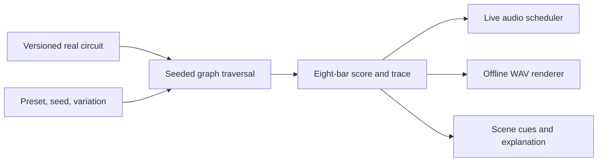

# Lo-fly beats: implementation plan

Created September 12, 2026. Based on [idea 21: Lofly — Beats to Buzz to](./01-IDEAS.md#21-lofly---beats-to-buzz-to).

Build a browser music toy where a small, real fruit-fly connectome graph helps compose lofi beats. An animated fly in oversized headphones studies beside an overripe banana while rain runs down the kitchen window. The music should be enjoyable enough to leave playing and the controls simple enough to explore immediately.

The repository currently contains the ideas document and this plan. The work below is proposed implementation work; dataset extraction, musical validation, and browser testing have not yet been performed.

## 1. Decisions and scope

| Decision | Direction | Status |
| --- | --- | --- |
| First release | Playable browser MVP: one real circuit, three music layers, presets, controls, and short audio export. | Confirmed by the user. |
| Application stack | React, TypeScript, and Vite; static hosting with browser audio. | Confirmed by the user. |
| Visual direction | Cozy illustrated 2D scene with subtle animation. | Confirmed by the user. |
| Connectome approach | Graph traversal drives musical choices. Neural simulation is a later project. | Follows idea 21. |
| Data source | A curated subset of MaleCNS `male-cns:v1.0`, distributed with the application. | Proposed; exact neurons selected in milestone 1. |
| Audio format | Synthesized instruments and generated ambience initially; eight-bar stereo WAV export. | Proposed implementation choice. |
| Hosting provider | Keep the build portable to a static host; select the provider when preparing deployment. | Does not block local implementation. |

The user has confirmed the release scope, stack, and visual direction. Numerical settings below are initial implementation targets to validate during the early milestones.

**MVP features**

- One continuous listening session generated from a documented real graph.
- Three musical layers: swung drums, warm chordal keys, and bass. Rain and vinyl texture are a separate ambience bus.
- Play/pause, master volume, tempo from 60–100 BPM, variation, and a **New beat** button.
- Mute and level controls for each musical layer, plus an ambience toggle.
- Three presets: **Rainy Windowsill**, **Overripe at 2 AM**, and **Fruit Bowl Finals**.
- One animated scene with the fly, headphones, six-sleeved hoodie, homework, banana, and rainy window.
- A short WAV download generated from the current musical settings.
- An expandable **How the beat is made** panel with data credits and a compact trace of the graph choices behind the music.
- Responsive layout, keyboard controls, and reduced-motion support.

**Later scope:** additional circuits, simulated neural activity, MIDI/stem/video export, uploaded audio, a full sequencer, saved song libraries, share links, accounts, social features, monetization, 3D environments, and whole-brain visualization. Mobile screen-locked playback and operating-system media controls are also later capabilities. Target continued listening while switching desktop tabs and validate that behavior early.

## 2. Listener experience

1. The page opens silently on the illustrated scene. A prominent **Start listening** button and the default preset establish what to do.
2. The first click enables browser audio and starts the three-layer arrangement. Show a loading state while the graph or audio assets become ready.
3. Tempo and variation adjust the feel. **New beat** chooses another seed; presets change the musical palette and the scene's lighting.
4. The fly bobs along while studying, blinks occasionally, and rubs its hands together at infrequent phrase boundaries. Rain continues quietly in the background.
5. **Export 8 bars** pauses listening, renders the selected phrase, and offers a WAV download. Show the expected duration before export and leave playback paused afterward.
6. Curious listeners can expand the explanation panel to see the source circuit, recent traversed connections, and how those choices became notes.

Keep the main screen focused on the scene and music controls. The explanation panel can show neuron IDs, annotations, original synapse counts, and the mapping version. The scene's jokes and status messages remain readable without understanding the implementation.

Suggested copy includes **“Beats to relax / repeatedly fly into the same window to”** and the track title **“No Thoughts, Only Fruit.”** Use short, infrequent jokes so they do not compete with listening.

**Control behavior**

| Action | Behavior |
| --- | --- |
| Play/pause | Pause freezes the musical position and fades active voices; resume continues from the saved beat. Repeated clicks cannot create additional audio engines. |
| Tempo | Apply at the next bar boundary; preserve position in musical time. |
| Variation | Apply at the next eight-bar phrase boundary; show the pending value until it becomes active. |
| New beat / preset | Prepare a replacement phrase and switch at the next phrase boundary. When paused, apply immediately and reset to the beginning. |
| Volume / layer mute | Apply promptly through a short gain ramp to avoid clicks. |
| Export | Use the active settings, excluding pending changes; make this clear before rendering. |
| Page hidden | Suspend visual animation while keeping desktop audio playing; test background scheduling in the early audio spike. |
| Audio interrupted | Detect actual context suspension/interruption, preserve musical state, and offer Play to resume without a burst of overdue notes. |

## 3. Real connectome data

MaleCNS publishes annotations and connectivity through bulk files and neuPrint. Its documentation identifies `male-cns:v1.0`, lists the full connection table at approximately 1.1 GB, and requires an account/token for programmatic neuPrint access. Prepare the subset during development and ship the resulting small static files. [MaleCNS download documentation](https://male-cns.janelia.org/download/).

The data's published license is CC BY 4.0. Include the dataset attribution, source and license links, and a description of the filtering performed in both the repository and the application's credits. [MaleCNS license statement](https://male-cns.janelia.org/download/), [CC BY 4.0](https://creativecommons.org/licenses/by/4.0/).

**Selection and extraction**

1. Inspect the available annotations and select one coherent, annotated local neuron neighborhood. Favor meaningful branching and recurring paths over isolated pairs or a mostly linear chain. The exact cell types and original IDs are an outcome of this step, not a claim already established by this plan.
2. Aim initially for 32–128 neurons and at most 2,000 directed edges. Start by evaluating a minimum of three synapses per connection, then compare the retained structure with thresholds of one and five. Record the chosen threshold and any size cap.
3. Prefer a reproducible Python preparation script using the public bulk files. Keep those files in an ignored local cache. If neuPrint provides a more practical targeted extraction and a developer has access, document the exact query and dataset instead. Credentials stay in the local preparation environment.
4. Preserve original neuron IDs as strings, annotation fields where available, connection direction, and the original integer synapse count. Confirm the upstream table's aggregation rules before combining rows; avoid counting overlapping regional summaries more than once.
5. Remove duplicate exported edges according to those rules, reject missing endpoints and invalid counts, sort output deterministically, and compute checksums. Retain unknown annotations explicitly.
6. Produce an extraction report with the selected IDs, region/type criteria, retained node and edge counts, branching, dead ends, connected components, and filtering effects. Curated starting neurons must belong to the exported graph.
7. Commit the small export, manifest, extraction configuration, and instructions. Application builds and CI consume the committed export and do not repeat the bulk download.

The release depends on a valid real subset. Small synthetic graphs are useful test fixtures, but the released application's data path must fail clearly if the real asset is unavailable or invalid.

**Planned data contracts**

| Record | Required content |
| --- | --- |
| `CircuitManifest` | Schema version, circuit ID, source dataset/release, source URLs, retrieval date, attribution/license, extraction script/config versions, input/output checksums, filtering rules, counts, and curated starting IDs. |
| `Neuron` | Original string ID; available cell type, region, and side annotations; explicit unknown values. |
| `Connection` | Original source ID, target ID, and integer `synapseCount`. |
| `CircuitGraph` | Manifest reference, neurons, and directed connections; construct sorted adjacency lists after validation. |

The musical mapping belongs in separately versioned composition code. A synapse count influences a compositional probability; it is not treated as a measured physiological strength. Describe the feature as **music shaped by real fly-brain wiring** and explain that the scale, rhythm, instruments, and probability mapping are authored choices.

## 4. Composition and audio design

Use a pure TypeScript composition engine that returns note events and a provenance trace. Both live playback and export consume this representation.



### Traversal and repeatability

- Pin a seeded random generator and a stable ordering of nodes and outgoing edges. Separate composition randomness from animation and ambience randomness.
- For each eight-bar phrase, derive its random stream from the session seed, phrase index, and mapping version. Start at a seeded choice from the manifest's curated starting neurons.
- Follow only retained directed edges. A starting probability rule is `p(edge) = synapseCount^alpha / sum(outgoing synapseCount^alpha)`, with `alpha = 2 - 1.5 * variation` and variation normalized to 0–1. Higher variation makes weaker retained connections more likely while preserving the graph's constraints.
- Take a bounded number of steps, initially one per beat. At a dead end, insert a rest and restart from a curated starting neuron on the next bar. Record restarts separately from actual graph edges.
- Phrase starts are also deliberate composition resets. They do not imply a biological connection between the end of one phrase and the start of another.
- At zero variation, repeat the first eight-bar score. Above zero, generate successive phrases with the documented seed derivation and retain some rhythmic motifs for continuity.
- Persist the session seed, active preset/version, mapping version, and settings locally. Reloading starts paused at phrase zero. Storage failure must not prevent listening.

The same graph checksum, engine/mapping versions, seed, phrase index, and settings must produce identical note events and traversal traces. Audio rendering can vary slightly across browser implementations; deterministic composition does not require byte-identical WAV files across browsers.

### Mapping the graph into music

| Ingredient | Musical use | Constraint |
| --- | --- | --- |
| Visited neuron ID and available cell type | Stable mapping into a small authored library of chord and bass motifs. | Record the mapping rule; use an ID-based fallback when annotations are absent. |
| Directed connections | Determine which traversal choices can follow the current node. | Every normal transition must exist in the exported graph. |
| Synapse count | Bias the selection of the next edge. | Preserve the raw count alongside the derived probability. |
| Node reached at a bar boundary | Select a chord from the preset's compatible chord vocabulary. | One musical key per preset; use bounded voice leading. |
| Nodes reached within the bar | Select bass rhythm and chord-tone patterns. | Keep bass in a low register and align strong beats with the active chord. |
| Phrase position and variation | Control motif reuse, fills, and sparse embellishments. | Bound note density and repeat patterns enough to establish a groove. |

Use 4/4 time, an eighth/sixteenth-note grid, controlled swing, and small seeded velocity/timing variations. Keep the core drum groove authored: kick, snare, and hats establish the beat while the graph provides the bass and harmonic choices. Apply swing in one shared scheduling adapter so live playback and export agree.

Start with a compact set of compatible minor-key seventh/ninth chords and bass motifs. Tune the exact vocabulary through listening. A mapping that produces varied traces but unpleasant music has not met the product goal.

### Sound palette and presets

| Preset | Initial tempo | Direction |
| --- | --- | --- |
| Rainy Windowsill | 72 BPM | Soft keys, rounded bass, light hats, audible rain, muted blue light. |
| Overripe at 2 AM | 64 BPM | Darker voicings, fewer drum hits, gentle saturation, amber desk light. |
| Fruit Bowl Finals | 86 BPM | Brighter chords, more active bass, occasional fills, warmer daylight. |

Begin with synthesized drums, a warm electric-piano-style voice, a rounded mono bass, and seeded noise buffers for rain/crackle. Use a shared instrument/effects factory with bounded polyphony, filtered ambience, conservative gain, and a master limiter. If synthesis cannot meet the listening bar, replace selected voices with a small set of appropriately licensed, locally hosted samples and record their sources in an asset manifest.

Tone.js is the proposed audio layer because it supplies musical scheduling, synths, and effects. Enable audio from the Play interaction and use the scheduler's supplied audio timestamps. [Tone.js documentation](https://tonejs.github.io/). Browsers require user interaction to start or resume audio; volume controls and native, labeled form controls also fit this interface. [Web Audio best practices](https://developer.mozilla.org/en-US/docs/Web/API/Web_Audio_API/Best_practices).

Keep the audio engine outside React render lifecycles. Own one live engine, dispose voices and scheduled events explicitly, and drive visual updates from the musical clock without using animation frames as the audio clock. Hold only the current and next phrases in memory during continuous playback.

### WAV export

1. Capture an immutable snapshot of the active phrase's score, tempo, seed, graph/mapping versions, instrument settings, master volume, layer levels/mutes, and ambience state. Export the whole phrase from its beginning, even if playback is midway through it. Use the captured tempo and mix throughout the clip; this exports the current arrangement, not a recording of earlier live control changes.
2. Pause live playback. Create fresh offline instruments and effects through the same factory, with an explicitly supplied audio context. Serialize exports and prevent live engine reinitialization during rendering.
3. Render eight bars at the captured tempo, followed by a two-second release tail and a short end fade. This gives approximately 21–34 seconds across the 60–100 BPM range. The result is a listening clip; seamless-loop export is deferred.
4. Encode stereo, 44.1 kHz, 16-bit PCM WAV. Use seeded noise and effect buffers where randomness affects the sound, and include the preset and seed in the filename.
5. Show preparing/rendering/encoding/ready states, release temporary buffers and object URLs, and return to a usable paused state on success or failure. Do not display an invented percentage when the renderer supplies no progress value.

`OfflineAudioContext` renders scheduled audio into a buffer, which the application must then encode as WAV. [OfflineAudioContext reference](https://developer.mozilla.org/en-US/docs/Web/API/OfflineAudioContext). Tone's offline helper is a possible adapter, but verify the selected package version's context handling during the first audio spike. [Tone.js offline implementation](https://github.com/Tonejs/Tone.js/blob/dev/Tone/core/context/Offline.ts).

## 5. Application and visual structure

Use the confirmed React, TypeScript, and Vite stack for the static application. Keep application state small: a reducer/store for the active recipe, pending control changes, transport state, and export state. The composition engine should have no React, DOM, or audio-node dependencies. [Vite getting started](https://vite.dev/guide/).

Suggested layout, to create as the milestones need it:

```text
src/
  app/                 # App shell and session/control state
  components/          # Player, mixer, presets, export, explanation panel
  scene/               # Scene layers, animation states, musical cue adapter
  connectome/          # Schema validation, graph loading, adjacency building
  music/               # Seeded traversal, harmony, motifs, score generation
  audio/               # Engine, instrument factory, scheduling, export, WAV
  presets/             # Versioned musical and visual preset definitions
  styles/              # Layout, color, type, responsive and motion rules
public/
  data/                # Circuit JSON and provenance manifest
  art/                 # Optimized scene layers and character frames
  audio/               # Optional locally hosted sample assets
scripts/
  data/                # Preparation script, pinned dependencies, selection config
tests/
  fixtures/            # Tiny hand-checkable graphs and known score examples
  browser/             # Playback, controls, interruption, and export checks
docs/
  01-IDEAS.md
  01-PLAN.md
```

Define a versioned `SessionRecipe` and `PhraseScore`. A score contains events in musical time, per-layer notes/durations/velocities, phrase length, and graph decisions that explain each selected motif. Keep the active score and pending settings distinct so the UI and exporter cannot accidentally use different recipes.

Select compatible stable dependency releases when scaffolding, pin the supported Node runtime, and commit the package lock. Use npm scripts for development, build, type checking, linting, data validation, and tests.

**Scene implementation**

- Build one composition from a background, desk/banana foreground, fly body/head/arms, window rain, and lighting layers. Use layered image assets with CSS transforms or a small canvas where needed; native HTML remains responsible for controls.
- Establish the fly's silhouette and expression before polishing decoration. Prepare separate frames or layers for idle, studying, head bob, blink, and hand rubbing.
- Tie gentle head movement to the beat and occasional actions to phrase events. Seed animation separately so hiding the scene or changing frame rate cannot change the music.
- Give each preset lighting and color variations using the same scene assets.
- Respect reduced motion and provide an explicit animation toggle. Keep the still illustration appealing and the controls fully usable when animation is disabled.
- On mobile, stack the controls below a cropped scene while retaining visible play/pause and volume controls. Keep text and button contrast readable against the illustration.
- Track artwork and any audio asset sources in an asset manifest; optimize assets before the release build.

## 6. Implementation milestones

Complete these in dependency order. Each milestone should leave a demonstrable result and a clear check before proceeding.

| Milestone | Work | Exit criteria |
| --- | --- | --- |
| **1. Scaffold and validate the inputs** | Scaffold the app and checks; inspect source schemas; select/export the real subset and manifest; build a minimal Play button and short offline-render spike. | Clean install/build succeeds; the real graph validates; original IDs and sample edge counts can be checked against the source; a short sound plays and exports in the target desktop browsers. Test desktop tab switching and record the exact circuit choice and any unresolved compatibility issues. |
| **2. Build the musical core** | Implement seeded traversal, score/provenance contracts, harmony/bass mapping, drums, instrument factory, and shared timing. | A real-graph arrangement plays for five minutes; the same recipe reproduces its events; every non-restart transition is valid; candidate presets pass initial listening review. |
| **3. Complete the player and export** | Add active/pending controls, preset transitions, mixer, New beat, persistence, eight-bar WAV, and loading/error/interruption behavior. | All controls have the specified timing behavior; repeated interaction creates no duplicate audio; exported notes and timing match the captured score and the file plays in an independent audio player. |
| **4. Build the scene and explanation** | Create the illustrated scene and animation states, responsive layout, reduced-motion controls, restrained comedy, trace view, and credits. | The fly/banana scene reads clearly on desktop and mobile; keyboard-only use works; visuals follow playback without affecting it; real connections and authored musical rules are distinguishable in the explanation. |
| **5. Validate and prepare release** | Run the targeted automated and manual checks; tune presets and gain; measure memory/assets; write setup, data regeneration, and deployment instructions; produce a static production build. | The acceptance checklist below passes on the documented browser/device matrix, with any unsupported behavior stated accurately. The build is ready to deploy to the selected host. |

**First implementation task:** scaffold the static app and obtain a verified graph export, then make a single real traversal produce a short audible phrase and a WAV. This tests the two central dependencies before investing in finished illustration.

## 7. Validation and acceptance

Use focused unit tests for graph invariants and composition, and browser tests for the interactions that involve real audio contexts and downloads. Vitest and Playwright are proposed tools. [Vitest guide](https://vitest.dev/guide/), [Playwright documentation](https://playwright.dev/docs/intro).

| Area | Evidence required |
| --- | --- |
| Data integrity | Schema and checksums validate; IDs are unique strings; endpoints exist; counts are positive integers; exported samples match the upstream records; the manifest describes all filtering. |
| Graph contribution | On a hand-checkable branching fixture, changing a permitted connection or its weight changes expected choices for fixed test seeds; on the real graph, every normal trace step is an exported edge. Test dead ends separately. |
| Repeatability | Fixed graph/recipe/version inputs reproduce the same events and trace; changing animation or UI update frequency has no effect. |
| Musical constraints | Notes remain within the defined chord/scale rules and registers; event density and polyphony stay bounded; phrase length and swing timing are correct. |
| Audio lifecycle | Start requires an interaction; play/pause, rapid toggles, preset changes, and export leave one usable engine without hanging notes or duplicate playback. |
| Export | WAV headers, channels, sample rate, bit depth, duration, and non-silent output validate; a known score renders the intended onsets; playback settings and export settings agree. |
| Failure recovery | Missing/corrupt graph, asset failure, audio suspension, failed export, and unavailable local storage produce usable recovery paths. |
| Accessibility | All controls work by keyboard with labels and visible focus; essential state has text equivalents; reduced motion and animation-off work; export status is announced without announcing every beat. |
| Listening quality | Audition all three presets across at least three seeds for two minutes each; check low and high variation plus tempo limits. Hear a stable groove, compatible bass/chords, useful differences between presets, and no clicks or harsh clipping. |
| Sustained use | A 15-minute foreground session, five minutes in a background desktop tab, and repeated exports show no unintended stops, accumulating voices, scheduled events, or retained temporary buffers. |

Target the current stable desktop Chrome, Firefox, and Safari releases, then manually verify playback, controls, interruption recovery, and downloads on iOS Safari and Android Chrome. Record the actual versions and devices tested. Automated WebKit tests supplement a real Safari check.

Initial performance budgets are a compressed graph below 200 KiB, total first-session transferred assets below 4 MiB, and audible output within two seconds of Play once required assets are loaded. Measure these on a documented reference laptop and phone. Simplify scene animation or instrument/effect cost if foreground audio breaks up. Verify the eight-bar export's memory use on mobile before promising mobile export support.

**MVP completion checklist**

- [ ] A first-time visitor can start an enjoyable beat without setup or an account.
- [ ] One verified real circuit materially selects the bass and chord motifs.
- [ ] Three musical layers, three distinct presets, tempo, variation, mixer, and New beat work together.
- [ ] The illustrated fly studies beside the banana and responds subtly to the music.
- [ ] Eight-bar WAV export uses the captured score and settings and downloads successfully on the supported platforms.
- [ ] The graph source, license, filtering, and authored mapping are documented and credited.
- [ ] Keyboard access, reduced motion, errors, and audio interruptions have been verified.
- [ ] Required checks pass and the production build can be served by a static host.

## 8. Risks, deployment, and later work

| Risk | Response |
| --- | --- |
| The selected graph is too sparse or repetitive. | Inspect branching and short traversals in milestone 1. Adjust the documented subset/filtering; retain rests and explicit restarts where needed. |
| Raw graph choices do not make pleasant music. | Keep harmony, rhythm, register, and density constrained by an authored musical vocabulary. Evaluate alternative mappings with the same seeds and traces during listening review. |
| Browser timing or interruption behavior damages playback. | Use audio-clock scheduling, bound queued work, test desktop background scheduling, and recover deliberately from actual audio interruptions on real desktop/mobile browsers. |
| Export and live playback diverge. | Share the immutable score, timing adapter, instrument factory, and seeded audio resources; isolate offline rendering from the live context. |
| Art production expands the MVP. | Finish one scene with a few reusable character states and preset lighting variations. Validate sound before polishing the scene. |
| Source acquisition or asset availability delays the build. | Resolve the real data path in milestone 1, bundle the validated subset, and start with synthesized sound. Track any remaining asset dependencies explicitly. |

The delivery artifact is a static `dist/` build. Serve the graph and assets from the same origin, use deployment-base-aware asset paths, and verify the production preview before configuring the chosen host. The application needs no runtime backend, database, secret, or neuPrint connection. [Vite static deployment guide](https://vite.dev/guide/static-deploy.html).

Include a README with local setup, build/check commands, browser support, audio behavior, and the precise data-regeneration steps. Keep the source/license credits and asset manifest alongside the implementation. Hosting setup and publication belong to the implementation/release stage; this document does not perform them.

After the MVP, consider reproducible share links and saved recipes, additional scene/circuit presets, MIDI and stems, and a focused comparison between graph traversal and a simple musical baseline. A neural-model variation should be scoped separately: name its dataset and dynamics, validate its activity, then introduce explicit mappings from modeled signals to filter movement or drum density.
