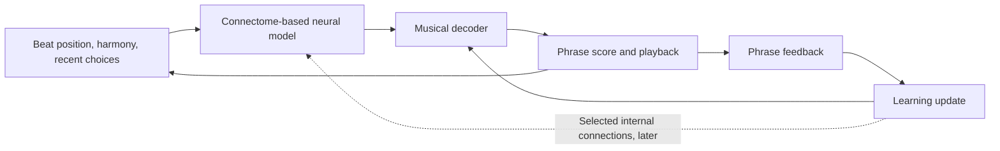

# Lo-fly beats: a fly that learns to make radio

Created October 4, 2026. Proposed product and research direction, recorded from the discussion about training the fly to create lofi beats on the fly. The architecture and learning methods below remain proposals.

## The idea

Move toward a 24/7 station where listeners watch one persistent simulated fly develop its own musical habits. The fly accumulates experience, remembers successful motifs, and gradually changes how it plays. Listeners can return tomorrow to hear what it has learned.

The central promise is **the same fly, still learning**. A cozy listening room, a recognizable musician, and music that evolves across hours and days give the project a reason to exist beyond an adjustable beat generator.

## Where the project is today

The current application loads the traced MaleCNS connectome and uses a seeded, synapse-count-weighted walk to select musical material. Each eight-bar phrase begins a fresh walk. Neuron IDs and types select authored bass, keys, and chord patterns; musical rules keep the arrangement coherent. There is no learned preference or persistent neural activity between phrases.

The relevant boundaries already exist in [traversal](../src/music/traversal.ts), [harmony](../src/music/harmony.ts), [composition](../src/music/compose.ts), and the [playback sequencer](../src/audio/sequencer.ts). The score representation, instruments, and separation between composition and playback provide useful foundations for an experiment.

Giving the fly persistent musical state would already be a meaningful step. Learning would then change how that state produces future decisions.

## A proposed learning loop

The model receives musical context: where it is in the beat, the current harmony, and what it recently played. Activity propagates through a recurrent model based on the fly's wiring. A decoder turns that activity into constrained musical actions, such as choosing a bass motif, varying a drum pattern, resting, or changing chords.

Feedback after a phrase nudges future decisions. Musical context and neural state continue across phrase boundaries, while learned parameters persist across sessions and service restarts.

There is research precedent for simulating activity through fly wiring. Shiu and colleagues built a simplified spiking model that predicted aspects of feeding and grooming. Applying a model to composition would be our own experiment; neuronal dynamics, musical inputs, and output mappings would require explicit engineering choices. [Shiu et al., Nature, 2024](https://www.nature.com/articles/s41586-024-07763-9).

The connectome supplies anatomical connectivity. Original synapse counts should remain intact as source data, with modeled effective weights and learned changes stored separately. Anatomical counts alone do not provide all the physiological parameters needed for a simulation.

## Two stages of training

### 1. Teach a musical vocabulary

Begin with a modest model and a small set of musical decisions. Use curated MIDI examples to train a decoder from neural activity to musical actions. Keep the existing harmony, rhythmic structure, and sound palette as the foundation while testing whether the model can retain and vary motifs.

Reservoir computing offers a starting approach: a recurrent network supplies temporal state, and its output connections are trained. This stage trains the musical decoder; the internal connectome-based connections can remain fixed while the approach is evaluated. [Jaeger's echo-state network report](https://www.ai.rug.nl/minds/uploads/EchoStatesTechRep.pdf).

### 2. Add learning inside the simulated circuit

Let selected internal connections adapt through reward, so experience changes future neural activity as well as the decoder. Start with a bounded set of adaptable connections and expand after the behavior is useful and stable.

The mushroom body offers biological inspiration for this stage. Dopamine modulates associative learning at connections between Kenyon cells and mushroom body output neurons. A musical reward and its connection to plasticity would be an engineered adaptation of that principle. [Aso and Rubin, eLife, 2016](https://elifesciences.org/articles/16135/figures).

The existing MBON-only regression dataset does not contain the complete learning circuit described in that research. Circuit selection, additional annotations, and model parameters would need to be established during the experiment.

## What earns a banana?

Defining useful feedback is likely the hardest part. Initial signals could reward harmonic compatibility, groove, motif continuity, and variation over longer stretches. A single simplistic score could teach the fly to repeat one safe bassline forever.

Balance coherence with exploration, preserve successful motifs, and compare actual listening examples. Automated scores are proxies for the listening experience. Give the model a decent musical foundation before it starts adapting live.

An optional **give banana** reaction could contribute gently to feedback. Listener reactions should influence learning slowly enough that the station remains musically coherent; they are one signal alongside the musical objectives.

## The listener experience

- One shared, persistent fly plays for everyone.
- The main controls are listening and volume, with an optional small brain view.
- Musical habits evolve across hours and days.
- Occasional messages, such as “rediscovered yesterday's bassline,” describe recognizable moments without competing with the music.
- A banana reaction may offer lightweight participation.

Learning displays should reflect recorded model behavior. The brain view can eventually show simulated activity and learning updates, with a clear explanation of the modeling assumptions. The current traversal highlights would need to change with the generator.

## What a 24/7 station requires

The current application runs entirely in each listener's browser. A shared station needs an always-running service to own musical generation, learning, the station timeline, and saved checkpoints. Every listener joins the same musical session rather than starting an independent fly.

The service can prepare upcoming phrases and apply bounded training updates between phrases while buffered playback continues. Save known-good checkpoints so restarts recover both musical progress and learned behavior. Decide the audio transport and hosting approach after measuring the prototype; those choices are still open.

The existing score and audio boundaries should help preserve a consistent sound while changing the generator and where it runs.

## First milestone

Build an audible learning experiment before committing to the station infrastructure:

1. Give the model persistent musical context and a constrained vocabulary.
2. Teach it a recognizable motif.
3. Check whether it retains that motif and produces useful variations.
4. Compare recordings with the current generator and with learning disabled under comparable musical conditions.
5. Save and restore the learned state, then verify that the behavior survives a restart.

Judge success through both musical measurements and listening comparisons. The experiment should demonstrate retained experience and useful variation, not just a rising reward score. Further comparisons with altered connectivity can test whether the chosen fly wiring contributes to the behavior.

Once this works, expand into internal plasticity and shared radio operation. That gives the livestream something concrete to show: a fly accumulating experience and developing a recognizable musical voice.
